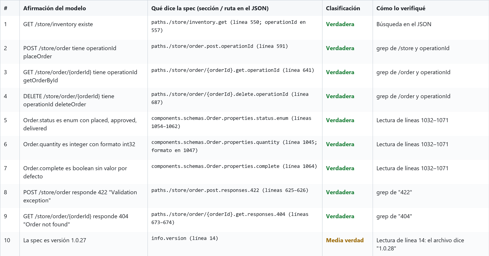

# Verificación de afirmaciones: Swagger Petstore v3 (órdenes de la tienda)

Fuente local: `petstore-openapi.json` (versión 1.0.28)

| # | Afirmación del modelo | Qué dice la spec (sección / ruta en el JSON) | Clasificación | Cómo lo verifiqué |
|---|---|---|---|---|
| 1 | GET /store/inventory existe | `paths./store/inventory.get` (línea 550; `operationId` en 557) | Verdadera | Búsqueda en el JSON |
| 2 | POST /store/order tiene operationId `placeOrder` | `paths./store/order.post.operationId` (línea 591) | Verdadera | grep de `/store` y `operationId` |
| 3 | GET /store/order/{orderId} tiene operationId `getOrderById` | `paths./store/order/{orderId}.get.operationId` (línea 641) | Verdadera | grep de `/order` y `operationId` |
| 4 | DELETE /store/order/{orderId} tiene operationId `deleteOrder` | `paths./store/order/{orderId}.delete.operationId` (línea 687) | Verdadera | grep de `/order` y `operationId` |
| 5 | `Order.status` es enum con `placed`, `approved`, `delivered` | `components.schemas.Order.properties.status.enum` (líneas 1054–1062) | Verdadera | Lectura de líneas 1032–1071 |
| 6 | `Order.quantity` es integer con formato int32 | `components.schemas.Order.properties.quantity` (línea 1045; formato en 1047) | Verdadera | Lectura de líneas 1032–1071 |
| 7 | `Order.complete` es boolean sin valor por defecto | `components.schemas.Order.properties.complete` (línea 1064) | Verdadera | Lectura de líneas 1032–1071 |
| 8 | POST /store/order responde 422 "Validation exception" | `paths./store/order.post.responses.422` (líneas 625–626) | Verdadera | grep de `"422"` |
| 9 | GET /store/order/{orderId} responde 404 "Order not found" | `paths./store/order/{orderId}.get.responses.404` (líneas 673–674) | Verdadera | grep de `"404"` |
| 10 | La spec es versión 1.0.27 | `info.version` (línea 14) | Media verdad | Lectura de línea 14: el archivo dice `"1.0.28"` |

Esta misma tabla también está disponible en formato PNG, para verla mejor en el PR:

## Conclusión

- 9 de 10 afirmaciones coinciden exactamente con `petstore-openapi.json`, así que son confiables; ninguna resultó inventada.
- La única imprecisión fue la versión: se citó 1.0.27 tomándola de la URL en vivo, pero el archivo local es 1.0.28, por lo que la afirmación se clasifica como "media verdad".
- El único tipo de error fue "versión mezclada" (1 de 10); no hubo errores en endpoints, campos, tipos, enums ni códigos de respuesta.
